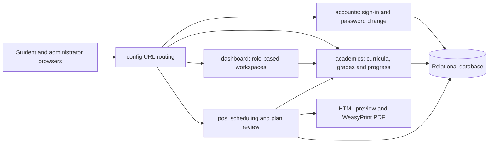
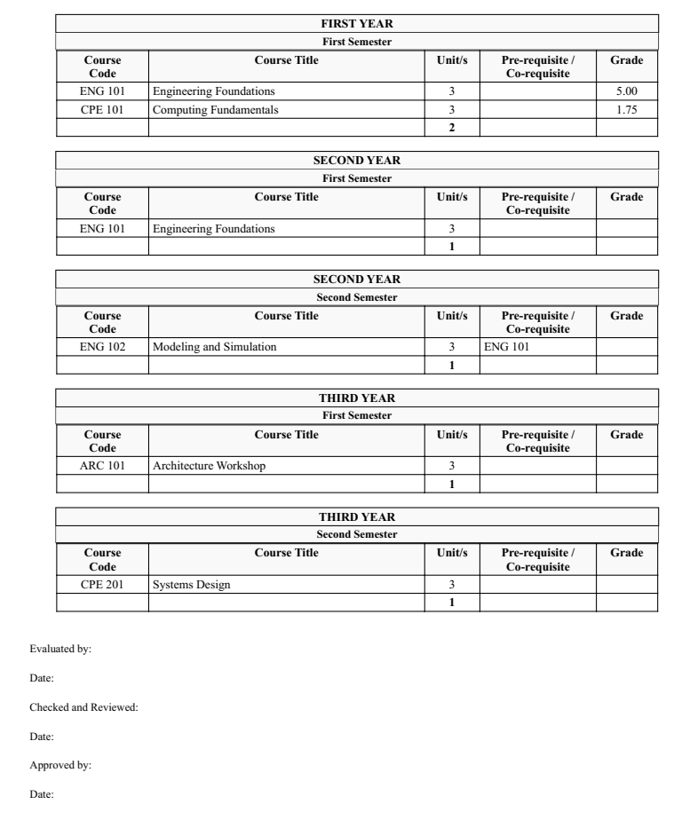

# BackonTrack: Auto-POS

*Automated Program of Study Evaluation and Rearrangement System*

BackonTrack is an academic web application that helps students review curriculum progress and generate a revised Program of Study (POS). It uses course records and curriculum rules to propose a term-by-term plan for required courses and retakes.

**Development role** — Primary Full-Stack Developer. I developed and integrated the Django backend and template-based frontend into the complete application. This was an academic group project, with additional backend development contributions from a teammate.

## Problem statement

A failed, skipped, or delayed course can block later courses and change a student's semester load. Preparing a revised plan by hand means cross-checking grades, prerequisite and co-requisite relationships, the curriculum's scheduled terms, and unit limits. BackonTrack brings those inputs together and shows the resulting schedule alongside the original course history.

## Features

| Area | Implemented workflows |
| --- | --- |
| Student workspace | Sign in, enter or upload grades, view course records and progress, and generate and revisit draft study plans. |
| Administrator workspace | Register students individually or by import, list students, and create or list curricula, courses, curriculum placements, and course requirements. |
| File imports | Preview and confirm student and curriculum spreadsheet imports. Curriculum parsing also supports structured DOCX and text-based PDF. Grade upload extracts text from PDF or applies OCR to supported images. |
| Plan review and export | Review a combined term-by-term plan with original and rearranged rows, open an HTML report preview, and download a PDF. |

See the [feature verification matrix](docs/FEATURE_VERIFICATION.md) for evidence, test coverage, and workflow limits.

## Technology stack

| Layer | Repository implementation |
| --- | --- |
| Backend | Python, Django 6.0.4, Django ORM and session authentication |
| Frontend | Django Templates, HTML, custom CSS, Bootstrap 5.3.3, and small JavaScript enhancements |
| Database | PostgreSQL via `psycopg2-binary`. Settings accept `DATABASE_URL` or individual PostgreSQL variables. |
| Document processing | pandas, openpyxl, python-docx, pdfplumber, Pillow, and pytesseract |
| PDF | WeasyPrint 68.1 with native Pango libraries |
| Serving | Django WSGI, WhiteNoise static assets, and Gunicorn declared for deployment. The shipped `Procfile` needs the correction recorded in the [repository audit](docs/REPOSITORY_AUDIT.md#setup-and-deployment). |

## Architecture

A single Django project serves both role-based workspaces. `academics` owns curriculum and course records, and `pos` reads those records to build draft plans. The detail page and PDF workflows use the same plan-display service. See the [architecture notes](docs/ARCHITECTURE.md) for the request flow and model relationships.



## How the POS rearrangement works

1. Load the required entries for the student's curriculum and identify credited passes and failed attempts. Start other outstanding courses in their curriculum slots and place unresolved retakes in the same term one year later.
2. Recheck planned years, prerequisites, co-requisites, and unit loads over successive passes. A planned prerequisite must precede its dependent course for the prerequisite rule to leave the dependent unchanged. Co-requisite handling can move the dependent to a later companion slot.
3. When a slot exceeds its unit limit, the scheduler tries moving other courses before retakes. Limits come from curriculum unit totals and fall back to a same-term curriculum limit or a built-in default. The curriculum term guides placement, and some overflow moves use other regular terms.
4. Save a new current draft with retakes and moved courses. The read view combines these items with curriculum placements and course records, preserving the original failed attempt alongside the proposed retake.

The scheduling loop runs up to 50 passes. See the [rearrangement notes](docs/POS_REARRANGEMENT.md) for the exact rules, data structures, and cases the heuristic can leave unresolved.

## Application screenshots

**Generated PDF excerpt** — Rendered from an actual export using synthetic data. The excerpt shows the course schedule and blank signature fields. The term summary displays the course count in its units column.



| Browser screenshot | Capture status |
| --- | --- |
| Login | Placeholder. Capture the empty sign-in form. |
| Student dashboard | Placeholder. Capture the progress summary for a synthetic profile. |
| Administrator dashboard | Placeholder. Capture the management navigation. |
| Curriculum management | Placeholder. Capture the curriculum course list with sample courses. |
| Grade input | Placeholder. Capture the manual grade form with synthetic entries. |
| POS rearrangement | Placeholder. Capture the plan generation confirmation page. |
| Generated study plan | Placeholder. Capture a synthetic failed attempt and its proposed retake. |
| PDF preview | Placeholder. Capture the HTML preview with student and contact fields excluded. |

## Project structure

```text
autopos/
├── accounts/       Custom user, email login, and password change
├── academics/      Curriculum, student records, imports, grades, and progress
├── dashboard/      Landing page and role-based dashboards
├── pos/            Plan generation, storage, display, and PDF export
├── config/         Django settings, routing, and WSGI/ASGI entry points
├── templates/      Shared layout and application templates
├── static/         Application stylesheet and images
├── docs/           Architecture, scheduling, feature verification, and audit
├── manage.py       Django management command entry point
├── requirements.txt
├── build.sh
└── Procfile
```

## Installation and local setup

Use Python 3.14 and a local PostgreSQL instance. PDF download additionally requires a working WeasyPrint native runtime. Image-grade uploads require the Tesseract executable on `PATH`. See the [WeasyPrint installation guide](https://doc.courtbouillon.org/weasyprint/v68.1/first_steps.html#installation).

1. From the repository root, create and activate a virtual environment, then install the pinned dependencies.

   ```powershell
   python -m venv .venv
   .\.venv\Scripts\Activate.ps1
   python -m pip install -r requirements.txt
   if (-not (Test-Path .env)) { Copy-Item .env.example .env }
   ```

   On macOS or Linux, activate with `source .venv/bin/activate` and run `test -e .env || cp .env.example .env`. If you already have an `.env`, add the missing settings using the example as a reference.

2. Create a database and a dedicated local login role. Open an administrative `psql` session, for example with `psql -h 127.0.0.1 -U postgres -d postgres`, then run the following. `\password` prompts interactively.

   ```sql
   CREATE ROLE autopos_app LOGIN;
   \password autopos_app
   CREATE DATABASE autopos OWNER autopos_app;
   ```

   In [`.env.example`](.env.example), `DATABASE_URL` shows the format expected by `.env`. Use the database and role you created, and URL-encode the password if it contains reserved characters. Alternatively, omit `DATABASE_URL` and set `DB_NAME`, `DB_USER`, `DB_PASSWORD`, `DB_HOST`, and `DB_PORT`. Generate a unique value for `SECRET_KEY` with `python -c "from django.core.management.utils import get_random_secret_key; print(get_random_secret_key())"` and store it locally. `ALLOWED_HOSTS` and `CSRF_TRUSTED_ORIGINS`, if needed, are read from the process environment.

3. Prepare the database and static files, then start the development server.

   ```shell
   python manage.py migrate
   python manage.py collectstatic --noinput
   python manage.py createsuperuser
   python manage.py runserver
   ```

4. Open `http://127.0.0.1:8000/`. Sign in through the administrator role to use the application dashboard. Use Django admin at `/admin/` to create the initial department and program, then create a curriculum and add or import its courses. For an isolated demo, use synthetic records and a local SMTP sink when testing registration. Set the SMTP values in `.env` to match that sink.

## Testing and verification

- **Executed** — Django's system check, migration, and static collection passed. On isolated PostgreSQL 17, all nine targeted academic tests passed, as did smoke tests covering grades, CSV imports, POS generation, and PDF export. Full discovery encountered a stale POS import and an email assertion failure.
- **Repository test coverage** — Academic tests cover parsing and grade entry. Email tests cover welcome messages and registration. POS tests include plan display, scheduling, and PDF template cases that were blocked by the discovery error.
- **Academic evidence and open checks** — The supplied brief contained no test results and the final academic PDF was unavailable. Browser responsiveness, deployment, live email, image OCR, and multi-page PDF layout remain unverified. [Detailed audit results](docs/REPOSITORY_AUDIT.md#testing-and-verification).

To rerun the repository suite, collect static assets first. With PostgreSQL, point Django at a dedicated local test setup whose role can create a test database.

```shell
python manage.py check
python manage.py collectstatic --noinput
python manage.py test
```

## Known limitations

- Plans depend on recorded grades and predefined curriculum rules. Course offering frequency, capacity, enrollment approvals, and each student's live timetable are outside the scheduler's inputs.
- Some dependency and unit-limit conflicts can persist, and proposed retakes can extend beyond the published curriculum years.
- Import quality depends on the source layout. PDFs need a readable text layer, OCR needs a separate executable, and legacy `.xls` files need an Excel reader absent from the pinned dependencies.
- The verification used synthetic records. Generated drafts support academic discussion and require review by an authorized adviser before use in official academic planning.

## Future improvements

- Add explicit offering calendars and flag unresolved prerequisite, co-requisite, and unit-limit conflicts before saving a draft.
- Add plan snapshots and a structured comparison of proposed and original term placements.
- Repair stale tests and add coverage for multi-year schedules, import variants, and PostgreSQL-backed verification in CI.
